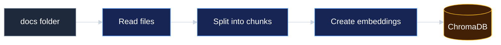
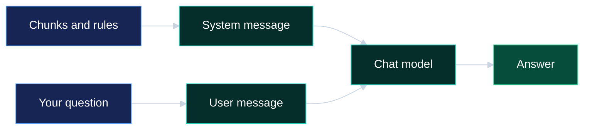
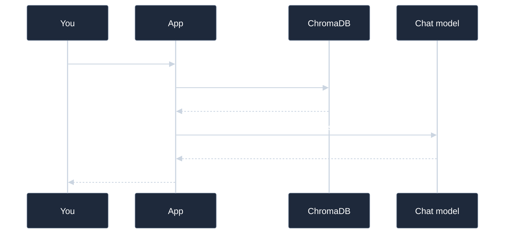

# RAG Pipeline

A simple RAG (Retrieval-Augmented Generation) system for your documents.

It reads the files in `docs/`, saves them as embeddings in a local ChromaDB database, finds the parts that match a question, and writes an answer using only those parts.

There are three steps:

1. **Ingestion.** Read the docs, split them into chunks, and save them.
2. **Retrieval.** Find the chunks that best match the question.
3. **AI generation.** Give those chunks to a chat model and get an answer.

---

## Pipeline Flow

```mermaid
%%{init: {"theme": "dark", "themeVariables": {"background": "#0b1220", "primaryColor": "#1e293b", "primaryTextColor": "#ffffff", "primaryBorderColor": "#64748b", "textColor": "#ffffff", "lineColor": "#cbd5e1", "fontSize": "15px", "edgeLabelBackground": "#0b1220", "clusterBkg": "#0f172a", "clusterBorder": "#334155", "secondaryTextColor": "#ffffff", "tertiaryTextColor": "#ffffff"}}}%%
flowchart LR
    subgraph A["Step 1: Ingestion"]
        D["docs folder"] --> L["Read files"]
        L --> C["Split into chunks"]
        C --> E["Create embeddings"]
        E --> V[("ChromaDB")]
    end

    subgraph B["Step 2: Retrieval"]
        Q["Your question"] --> S["Search ChromaDB"]
        V --> S
        S --> R["6 closest chunks"]
    end

    subgraph F["Step 3: AI generation"]
        R --> P["Add chunks to the rules"]
        P --> M["Chat model"]
        M --> O["Answer"]
    end

    classDef neutral fill:#1e293b,stroke:#64748b,color:#ffffff;
    classDef ingest fill:#172554,stroke:#60a5fa,color:#ffffff;
    classDef store fill:#422006,stroke:#fbbf24,color:#ffffff;
    classDef retrieve fill:#2e1065,stroke:#c084fc,color:#ffffff;
    classDef generate fill:#052e2b,stroke:#2dd4bf,color:#ffffff;
    classDef answer fill:#064e3b,stroke:#34d399,color:#ffffff;

    class D,Q neutral;
    class L,C,E ingest;
    class V store;
    class S,R retrieve;
    class P,M generate;
    class O answer;

    style A fill:#0f172a,stroke:#3b82f6,color:#ffffff;
    style B fill:#0f172a,stroke:#a78bfa,color:#ffffff;
    style F fill:#0f172a,stroke:#2dd4bf,color:#ffffff;
```



### Ingestion flow



### Retrieval flow


### AI generation flow



### How one question travels through the system



---

## How It Works

### Step 1: Ingestion

- Read every file in the `docs` folder.
- Split the text into chunks of 1000 characters, with 200 characters shared between chunks.
- Turn each chunk into an embedding, which is a list of numbers that represents its meaning.
- Save the embeddings in ChromaDB at `db/chroma_db`.
- If the database already exists, skip this step and open it instead.

### Step 2: Retrieval

- Turn the question into an embedding using the same embedding model.
- Search ChromaDB for chunks that are closest in meaning to the question.
- Take the 6 best matches. Each one also carries the name of the file it came from.

### Step 3: AI generation

- Put the assistant rules in a **system** message.
- Add the 6 chunks under `Context:` to that same message.
- Put the question in a **user** message.
- Send both messages to the chat model and print the answer.

**Prompting type.** Context stuffing, also called grounded prompting. We put the retrieved chunks straight into the system message so the model answers only from them. No examples are given, so it is also a zero-shot prompt.

The messages sent to the model look like this:

```python
[
    {"role": "system", "content": f"{system_prompt} \n\nContext:\n\n{context}"},
    {"role": "user", "content": user_query}
]
```

The assistant rules say: answer only from the context, say "I don't know" if the answer is not there, keep it short, and use plain text.

---

## Tech Stack

- **Python** 3.10+
- **LangChain** connects the steps
- **Docling** reads the documents
- **OpenAI-style API** makes embeddings and writes answers
- **ChromaDB** stores the embeddings on your computer
- **uv** manages the Python environment

---

## Project Structure

```text
.
├── docs/                    # Your documents go here
├── db/
│   └── chroma_db/           # Saved embeddings, git-ignored
├── src/rag_pipeline/
│   ├── config.py            # Reads settings from .env
│   ├── embeddings.py        # Builds the embedding model
│   ├── vectorstore.py       # Saves and opens ChromaDB
│   ├── ingestion/
│   │   ├── loader.py        # Reads the files
│   │   └── chunker.py       # Splits text into chunks
│   ├── retrieval/
│   │   └── retriever.py     # Finds the closest chunks
│   ├── generation/
│   │   ├── prompt.py        # Assistant rules and message format
│   │   ├── llm.py           # Builds the chat model
│   │   └── answer.py        # Gets the answer from the model
│   └── scripts/
│       └── pipeline.py      # Runs the whole flow
├── .env.example             # Settings template
├── pyproject.toml           # Project and dependencies
├── uv.lock
└── README.md
```

---

## Prerequisites

- Python 3.10+
- [uv](https://docs.astral.sh/uv/)
- An API key and base URL from an OpenAI-style provider, for example OpenAI or OpenRouter
- An embedding model and a chat model from that provider
- At least one document in `docs/`
- No database server needed, ChromaDB saves to a local folder

---

## Setup

### 1. Clone the repo

```bash
git clone https://github.com/<your-username>/rag-pipeline.git
cd rag-pipeline
```

### 2. Install dependencies

```bash
uv sync
```

Or create the environment yourself:

```bash
uv venv .venv
source .venv/bin/activate
uv sync
```

### 3. Set your settings

```bash
cp .env.example .env
```

Fill in your API key, base URL, embedding model, chat model, and collection name. Leave the Chroma cloud values empty for local use. All keys must exist in `.env`, even if some are empty.

### 4. Add documents

Put your files in `docs/`:

```text
docs/
├── 01_example_document.txt
├── 02_another_document.txt
└── ...
```

---

## Run it

```bash
uv run python -m rag_pipeline.scripts.pipeline
```

You will see the `Search:` prompt. Type a question and press Enter. The first run builds the database, and later runs reuse it.

The `rag-pipeline` command in `pyproject.toml` is still a placeholder. Use the command above.

---

## Settings

| Variable | Needed | What it is |
|---|---|---|
| `OPENAI_API_KEY` | Yes | Your API key |
| `OPENAI_API_URL` | Yes | Provider address, for example `https://api.openai.com/v1` or `https://openrouter.ai/api/v1` |
| `EMBEDDING_MODEL` | Yes | Model that turns text into embeddings |
| `AI_MODEL` | Yes | Chat model that writes the answer |
| `CHROMA_COLLECTION_NAME` | Yes | Name of the ChromaDB collection |
| `CHROMA_API_KEY` | Leave empty locally | Only used for ChromaDB Cloud |
| `CHROMA_TENANT` | Leave empty locally | Only used for ChromaDB Cloud |
| `CHROMA_DATABASE` | Leave empty locally | Only used for ChromaDB Cloud |

---

## Change things

- **New documents.** Add files to `docs/`, then delete `db/chroma_db` to rebuild.
- **Chunk size.** Change it in `ingestion/chunker.py`.
- **Number of chunks used.** Change `TOP_K` in `retrieval/retriever.py` (default 6).
- **Assistant rules.** Edit `DEFAULT_SYSTEM_PROMPT` in `generation/prompt.py`.
- **Models.** Change `EMBEDDING_MODEL` or `AI_MODEL` in `.env`.
- **Save location.** Change `PERSISTENT_DIR` in `vectorstore.py`.

---

## If something goes wrong

- **docs folder not found.** Create a `docs` folder in the project root.
- **No files found.** Add at least one document to `docs/`.
- **Vector DB already exists.** This is normal. Delete `db/chroma_db` if you want to rebuild it.
- **KeyError for a setting.** Copy `.env.example` to `.env`. Every key must be there, even empty ones.
- **No chunks found.** Build the database first and check that the collection name matches.
- **Answer says "I don't know".** The needed text was not in the chunks. Try more chunks or smaller chunks.
- **API errors.** Check your key, address, and model names.
