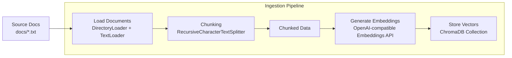

# Battlex RAG Pipeline

A lightweight **RAG ingestion pipeline** that turns plain-text documentation into searchable vector embeddings stored in **ChromaDB**.

This project currently implements the **ingestion pipeline**: loading source documents, splitting them into chunks, generating embeddings, and persisting them in a vector database.

---

## Ingestion Pipeline Flow



**Flow:** `Docs -> Chunking -> Chunked Data -> Embeddings -> Vector DB`

---

## How It Works

The ingestion pipeline is implemented in `src/rag_pipeline/ingestion_pipeline.py` and runs in three stages:

### 1. Load documents
- Reads all `.txt` files from the `docs/` directory.
- Uses LangChain's `DirectoryLoader` with `TextLoader`.
- Fails early if the directory is missing or contains no `.txt` files.
- Prints a preview of loaded documents (source, length, sample content, metadata).

### 2. Split documents into chunks
- Splits loaded documents using `RecursiveCharacterTextSplitter`.
- Default settings: `chunk_size=1000`, `chunk_overlap=0`.
- Produces embedding-friendly chunks while preserving source metadata.
- Prints sample chunks for quick inspection.

### 3. Create embeddings and store in vector DB
- Initializes `langchain_openai.OpenAIEmbeddings` with the configured OpenAI-compatible `base_url`, `api_key`, and `model`.
- Writes chunk embeddings into a ChromaDB Cloud collection using `langchain_chroma.Chroma`.
- Stores vectors with cosine distance metadata (`hnsw:space = cosine`).

---

## Tech Stack

- **Python** 3.10+
- **LangChain** (`langchain`, `langchain-community`, `langchain-text-splitters`)
- **OpenAI-compatible embeddings** (`langchain-openai`)
- **ChromaDB** vector store (`langchain-chroma`)
- **uv** / `pyproject.toml` for dependency and project management

---

## Project Structure

```text
.
├── docs/                         # Source .txt documents to ingest
├── src/
│   └── rag_pipeline/
│       ├── __init__.py
│       └── ingestion_pipeline.py # Load, chunk, embed, and store documents
├── pyproject.toml                # Project metadata and dependencies
├── uv.lock                       # Locked dependencies
└── README.md
```

---

## Prerequisites

- **Python 3.10+**
- **[uv](https://docs.astral.sh/uv/)** (recommended)
- An **OpenAI-compatible embeddings endpoint** (e.g. OpenAI or OpenRouter) with API key, base URL, and model name
- A **ChromaDB Cloud** setup (API key, tenant ID, database name, collection name)
- One or more `.txt` files in the `docs/` directory

---

## Setup

### 1. Clone the repository

```bash
git clone https://github.com/yasasbanukaofficial/battlex-rag-pipeline.git
cd battlex-rag-pipeline
```

### 2. Set up the environment and install dependencies

#### Option A: Quick setup with `uv sync` (recommended)

```bash
uv sync
```

#### Option B: Manual setup with `uv`

```bash
uv venv .venv
source .venv/bin/activate  # On Windows (PowerShell): .venv\Scripts\Activate.ps1
uv sync
```

### 3. Configure environment variables

Copy the sample file and fill in your values:

```bash
cp .env.sample .env
```

Update `.env` with your embeddings provider settings (OpenAI, OpenRouter, or another OpenAI-compatible provider) and ChromaDB Cloud credentials.

### 4. Add source documents

Place `.txt` files you want to ingest into `docs/`:

```text
docs/
├── 01_example_document.txt
├── 02_another_document.txt
└── ...
```

---

## Run the Ingestion Pipeline

```bash
uv run python -m rag_pipeline.ingestion_pipeline
```

Or, with an activated virtual environment:

```bash
python -m rag_pipeline.ingestion_pipeline
```

### Expected output

- Pipeline start message
- Documents loaded from `docs/`
- Preview of sample documents
- Chunking details and sample chunks
- Embedding creation and ChromaDB write confirmation

---

## Environment Variables Reference

| Variable | Required | Description |
|---|---|---|
| `OPENAI_API_KEY` | Yes | API key for the embeddings provider (OpenAI, OpenRouter, or compatible) |
| `OPENAI_API_URL` | Yes | Base URL for the OpenAI-compatible embeddings API |
| `EMBEDDING_MODEL` | Yes | Embedding model identifier/name |
| `CHROMA_API_KEY` | Yes | ChromaDB Cloud API key |
| `CHROMA_TENANT` | Yes | ChromaDB Cloud tenant ID |
| `CHROMA_DATABASE` | Yes | ChromaDB Cloud database name |
| `CHROMA_COLLECTION_NAME` | Yes | Target collection for stored vectors |

---

## Customization

- **Input folder:** update `DOCS_PATH` in `ingestion_pipeline.py` or pass a path to `load_documents(path=...)`.
- **Chunking:** adjust `chunk_size` and `chunk_overlap` in `split_documents(...)`.
- **File types:** extend `DirectoryLoader` (currently `*.txt` with `TextLoader`).
- **Collection settings:** modify Chroma collection metadata as needed.

---

## Troubleshooting

- **`FileNotFoundError: The directory docs doesn't exist`** — create a `docs/` folder in the project root.
- **`No .txt files are found...`** — add at least one `.txt` file to `docs/`.
- **Environment variable/key errors** — verify all required variables are set in `.env`.
- **Embedding or Chroma connection issues** — check API keys, endpoint URL, tenant/database/collection names, network access, and model compatibility.
