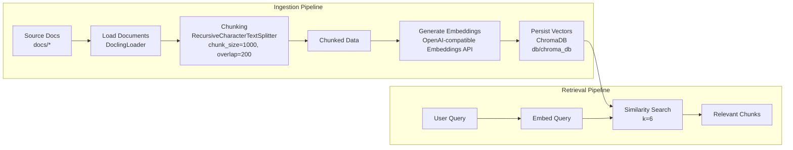

# Battlex RAG Pipeline

A lightweight **RAG pipeline** that turns documentation from `docs/` into searchable vector embeddings stored in a local **ChromaDB** database, then retrieves the most relevant chunks for a user query.

The project has two stages:

- **Ingestion** (`src/rag_pipeline/ingestion_pipeline.py`) — load documents, split them into chunks, generate embeddings, and persist them in a vector database.
- **Retrieval** (`src/rag_pipeline/retrieval_pipeline.py`) — embed a user query and search the persisted vector store.

---

## Pipeline Flow



**Ingestion flow:** `Docs -> Load -> Chunk -> Chunked Data -> Embeddings -> Local Vector DB`

**Retrieval flow:** `Query -> Embedding -> Similarity Search -> Results`

---

## How It Works

### 1. Ingestion Pipeline

Implemented in `src/rag_pipeline/ingestion_pipeline.py`.

#### Load documents
- Lists all files in `docs/` and loads them with `DoclingLoader` (`langchain-docling`), which replaced the sunset `langchain-community` `DirectoryLoader`/`TextLoader` pair.
- Keeps each document's `page_content` and a `source` metadata field.
- Fails early if `docs/` is missing or empty.
- Prints a preview of the first two documents (source, length, sample content, metadata).

#### Split documents into chunks
- Uses `RecursiveCharacterTextSplitter` with `chunk_size=1000` and `chunk_overlap=200` in `main()`.
- Produces embedding-friendly chunks while preserving source metadata.
- Prints sample chunks for quick inspection.

#### Create embeddings and persist the vector store
- Initializes `langchain_openai.OpenAIEmbeddings` with the configured `base_url`, `api_key`, and `model` (`check_embedding_ctx_length=False`).
- Writes chunk embeddings into a **local** ChromaDB collection at `db/chroma_db` via `langchain_chroma.Chroma.from_documents(...)`.
- Stores vectors with cosine distance metadata (`hnsw:space = cosine`).
- If `db/chroma_db` already exists, re-processing is skipped and the existing store is opened instead.
- ChromaDB Cloud configuration is kept as commented-out alternative blocks in the source.

### 2. Retrieval Pipeline

Implemented in `src/rag_pipeline/retrieval_pipeline.py`.

- Prompts for a query with `Search:`.
- Builds the same `OpenAIEmbeddings` model and opens the local ChromaDB collection (`db/chroma_db`, name from `CHROMA_COLLECTION_NAME`).
- Runs `vector_store.similarity_search(query, k=6)`.
- Prints the page content of the six most similar chunks.
- Requires the ingestion pipeline to have created the local vector store first.

---

## Tech Stack

- **Python** 3.10+
- **LangChain** (`langchain`, `langchain-text-splitters`)
- **Docling** (`langchain-docling`, `marko`) for document loading
- **OpenAI-compatible embeddings** (`langchain-openai`)
- **ChromaDB** local vector store (`langchain-chroma`)
- **uv** / `pyproject.toml` for dependency and project management

---

## Project Structure

```text
.
├── docs/                         # Source documents to ingest
├── db/
│   └── chroma_db/                # Local ChromaDB persistence (git-ignored)
├── src/
│   └── rag_pipeline/
│       ├── __init__.py
│       ├── ingestion_pipeline.py # Load, chunk, embed, and persist documents
│       └── retrieval_pipeline.py # Query the persisted vector store
├── .env.example                  # Environment variable template
├── pyproject.toml                # Project metadata and dependencies
├── uv.lock                       # Locked dependencies
└── README.md
```

---

## Prerequisites

- **Python 3.10+**
- **[uv](https://docs.astral.sh/uv/)** (recommended)
- An **OpenAI-compatible embeddings endpoint** (e.g. OpenAI or OpenRouter) with API key, base URL, and model name
- One or more documents in the `docs/` directory (Docling-supported formats, e.g. `.txt`)
- No external database service is needed for the default local ChromaDB setup

---

## Setup

### 1. Clone the repository

```bash
git clone https://github.com/yasasbanukaofficial/battlex-rag-pipeline.git
cd battlex-rag-pipeline
```

### 2. Set up the environment and install dependencies

#### Option A: Quick setup with `uv sync` (recommended)

```bash
uv sync
```

#### Option B: Manual setup with `uv`

```bash
uv venv .venv
source .venv/bin/activate  # On Windows (PowerShell): .venv\Scripts\Activate.ps1
uv sync
```

### 3. Configure environment variables

Copy the sample file and fill in your values:

```bash
cp .env.example .env
```

Set your embeddings provider settings (OpenAI, OpenRouter, or another OpenAI-compatible provider) and the ChromaDB collection name. The `CHROMA_API_KEY`, `CHROMA_TENANT`, and `CHROMA_DATABASE` entries are only needed if you switch to the commented-out ChromaDB Cloud integration.

### 4. Add source documents

Place the documents you want to ingest into `docs/`:

```text
docs/
├── 01_example_document.txt
├── 02_another_document.txt
└── ...
```

---

## Commands

| Command | Description |
|---|---|
| `uv run python -m rag_pipeline.ingestion_pipeline` | Load docs, chunk, embed, and persist to `db/chroma_db` (skipped if the DB already exists) |
| `uv run python -m rag_pipeline.retrieval_pipeline` | Prompt for a query and print the top 6 matching chunks |

With an activated virtual environment, the `uv run` prefix can be dropped:

```bash
python -m rag_pipeline.ingestion_pipeline
python -m rag_pipeline.retrieval_pipeline
```

### Expected output

**Ingestion:**
- Pipeline start message
- Documents loaded from `docs/` and a preview of sample documents
- Chunking details and sample chunks
- Embedding creation and ChromaDB write confirmation (or a notice that the vector DB already exists)

**Retrieval:**
- `Search:` prompt and query embedding message
- Page content of the six most similar chunks

---

## Environment Variables Reference

| Variable | Required | Description |
|---|---|---|
| `OPENAI_API_KEY` | Yes | API key for the embeddings provider (OpenAI, OpenRouter, or compatible) |
| `OPENAI_API_URL` | Yes | Base URL for the OpenAI-compatible embeddings API |
| `EMBEDDING_MODEL` | Yes | Embedding model identifier/name |
| `CHROMA_COLLECTION_NAME` | Yes | Target collection for stored vectors |
| `CHROMA_API_KEY` | No | ChromaDB Cloud API key (only for the commented-out cloud integration) |
| `CHROMA_TENANT` | No | ChromaDB Cloud tenant ID (only for the commented-out cloud integration) |
| `CHROMA_DATABASE` | No | ChromaDB Cloud database name (only for the commented-out cloud integration) |

---

## Customization

- **Input folder:** update `DOCS_PATH` in `ingestion_pipeline.py`; the `path` argument of `load_documents(...)` only affects the directory existence check.
- **Chunking:** adjust `chunk_size` and `chunk_overlap` in `split_documents(...)`; `main()` currently uses `chunk_overlap=200`.
- **Persistence location:** change `PERSISTENT_DIR` (`db/chroma_db`) in both pipelines. Delete that directory to force re-ingestion.
- **Retrieval depth:** change `k=6` in `similarity_search(...)` in `retrieval_pipeline.py`.
- **Cloud storage:** uncomment the ChromaDB Cloud blocks in both pipeline files and replace the `persist_directory` arguments with the cloud credentials.

---

## Troubleshooting

- **`FileNotFoundError: The directory docs doesn't exist`** — create a `docs/` folder in the project root.
- **`No .txt files are found...`** — add at least one supported document to `docs/`; this check only tests whether files were loaded.
- **`Vector DB already exists. No need to re-process documents`** — expected when `db/chroma_db` is present; delete it to re-ingest updated documents.
- **Retrieval returns no results or fails to open the store** — run the ingestion pipeline first and confirm `CHROMA_COLLECTION_NAME` matches the collection used during ingestion.
- **Environment variable/key errors** — verify all required variables are set in `.env`.
- **Embedding or Chroma connection issues** — check API keys, endpoint URL, collection name, network access, and model compatibility.
